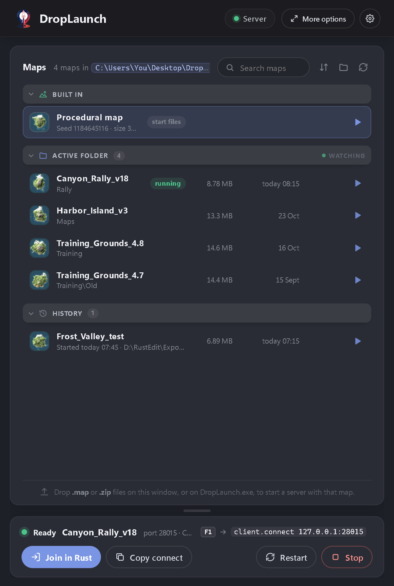
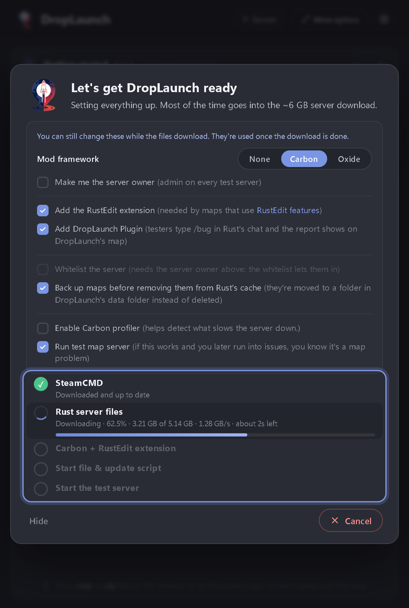
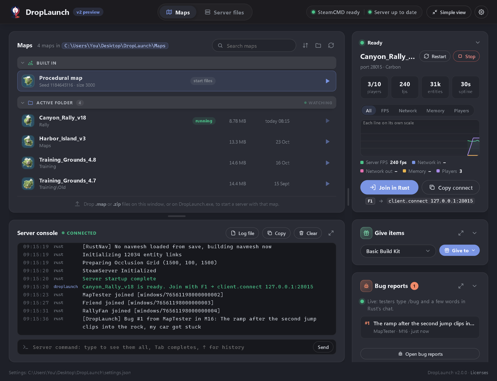
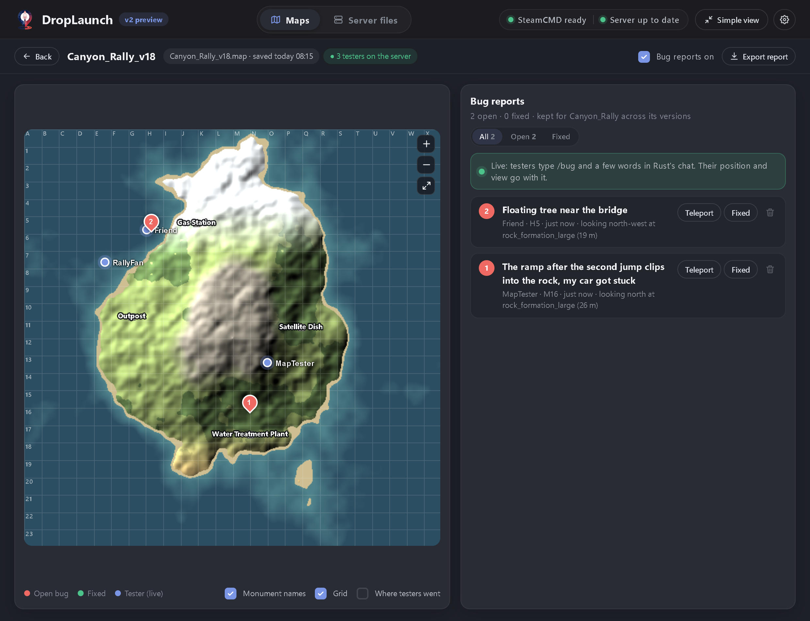

  

<h1 align="center">DropLaunch</h1>

  <b>Test your Rust maps on your own server, in one click.</b> 
  Drop a <code>.map</code> file on DropLaunch and it starts a Rust server with that map. 
  No SteamCMD commands, no batch files, no config to edit.

  <a href="https://github.com/tedpommes/DropLaunch/releases/latest"><b>⬇ Download DropLaunch</b></a>
  &nbsp;·&nbsp; Windows 10 / 11 &nbsp;·&nbsp; Free and open source

  
  &nbsp;
  

## What it does

- **Sets everything up for you.** The first time, one button downloads SteamCMD and the Rust
  server, adds Carbon or Oxide and the RustEdit extension, and can make you admin on every test
  server.
- **All your maps in one list.** Everything in your maps folder, plus the maps you started before.
  Click ▶ to start one, or drop a `.map` or `.zip` on the window.
- **Notices when you save in RustEdit.** Save a map and DropLaunch offers to restart the server
  with the new version.
- **Shows the server starting, step by step**, then **Join in Rust** gets you in with one click.
- **Bug reports from your testers.** They type `/bug` and a few words in Rust's chat, and the
  report shows up on a map of your island, with where they stood and which way they looked.
  Teleport there to see it yourself.
- **Gives items** to you and your testers, from kits you make.
- **More options** when you want them: the server console, live server stats, mods, start files,
  other server branches, and a cleanup for the maps Rust keeps in its cache.
- **Keeps itself up to date**, and the server files too.

  
   More options: the console, live stats, give items and bug reports, all next to your maps.

  
   Bug reports from testers, on a map of your island. Testers show up live while they play.

## Getting started

1. **Download** `DropLaunch.exe` from the [latest release](https://github.com/tedpommes/DropLaunch/releases/latest).
2. **Put it in an empty folder**, for example `C:\DropLaunch`. DropLaunch creates its folders
   next to itself: `SteamCMD`, `Server_Files` and `Maps`.
3. **Start it and click Set up.** The Rust server is about 6 GB, so the first setup takes 5 to 30
   minutes depending on your connection. You can close the setup window; it keeps going.
4. **Add your maps** to the `Maps` folder, or drop them on the window, and click ▶.
5. When it says **Ready**, click **Join in Rust**. (Or press F1 in Rust and type
   `client.connect 127.0.0.1:28015`.)

Turn on **Show me around** on the welcome screen and DropLaunch explains each step as you go.

## What you need

- Windows 10 or 11 (64-bit)
- About 7 GB of free disk space, for the Rust server
- Rust on Steam, to join your server

That's all: no installer, no .NET, no other downloads. DropLaunch is one small exe.

## Questions

**Windows says "Windows protected your PC".**
Windows shows this for programs that not many people have downloaded yet. Click **More info**,
then **Run anyway**. Every release is built from the source in this repository, and you can
check what it does here.

**My antivirus doesn't like it.**
Tools that download files and start servers sometimes get flagged by mistake. Please
[open an issue](https://github.com/tedpommes/DropLaunch/issues) saying which antivirus, so it can
be reported as a false positive.

**How do I update?**
DropLaunch tells you when a new version is out, and one click updates it. Every update is
signed: a download that was changed along the way is refused.

**How do I remove it?**
Stop any running server, then delete the DropLaunch folder. Its settings, kits and bug reports
are in `%LOCALAPPDATA%\DropLaunch`; delete that folder too.

**Where can I read about everything it does?**
In the [full guide](docs/GUIDE.md). Building it yourself: [development notes](docs/DEVELOPMENT.md).

## Code signing policy

Free code signing provided by [SignPath.io](https://signpath.io), certificate by
[SignPath Foundation](https://signpath.org).

- Committers and reviewers: [TedPommes](https://github.com/tedpommes)
- Approvers: [TedPommes](https://github.com/tedpommes)

Only `DropLaunch.exe` is signed, and only as built by this repository's GitHub Actions workflow
from its source. SteamCMD, the Rust server, Carbon, Oxide and the RustEdit extension aren't part
of DropLaunch: they're downloaded from their makers when chosen and aren't signed by this project.

## Privacy

DropLaunch has no accounts, no analytics and no telemetry. Its settings, maps, kits and bug
reports stay on your PC, and the Steam account it detects is read from Steam's files on this PC and
never sent anywhere. Its web requests carry nothing about you apart from what any connection does
(your IP address, and a user agent like `DropLaunch/<version>` that names the program).

It goes online on its own for two things:

- **Update check** (github.com, this repository's releases): a few seconds after it starts and
  every 6 hours while it's open. Settings switches it off.
- **The Rust server's branch list** (api.steamcmd.net, a public mirror of Steam's app info for the
  Rust server): once at every start, so the branch choice is there straight away.

And when you ask for it:

- **SteamCMD and the server files**: from Valve (steamcdn-a.akamaihd.net and Steam's servers).
- **Carbon, Oxide, the RustEdit extension**: from their GitHub pages, when chosen.
- **Item pictures in Kits**: from wiki.rustclash.com, or cdn.rusthelp.com when the first has
  none, kept in the `ItemIcons` folder so each is fetched once.
- **Links** (guides, the hosting companies on Rent a server) open in your browser only when
  clicked. The Rent a server links are affiliate links.

The Rust server DropLaunch starts is Facepunch's own server and goes online like any Rust server.

## License

DropLaunch is free software under the [GNU General Public License v3.0](LICENSE) or (at your
option) any later version. The libraries compiled into it keep their own licenses, listed in
**About** (see [Third-party notices](docs/GUIDE.md#third-party-notices)).
